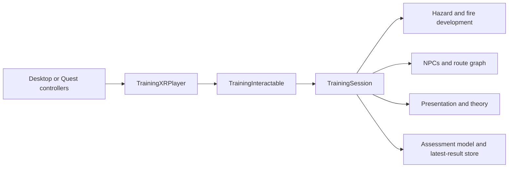

# Architecture

The active application is under `Assets/FireSafety`. The public snapshot preserves the current saved scene and its required dependencies; unrelated imported scenes and packs are omitted.

| Area | Main files | Responsibility |
|---|---|---|
| Session | `Runtime/TrainingSession.cs` | Trial lifecycle, events, route state and assessment completion |
| Input | `Runtime/TrainingXRPlayer.cs`, `TrainingControllerInput.cs`, `VRTrackingPolicy.cs` | Tracking, controller/desktop inputs, locomotion, recovery and equipment ownership |
| Interaction | `Runtime/TrainingInteractable.cs` | Maps world/menu actions to the session and equipment |
| Scenarios | `Runtime/TrainingGameSettings.cs` | Custom/random configuration and incident locations |
| Fire | `Runtime/TrainingHazard.cs`, `TrainingFireDevelopment.cs` | Source strength, suppression, spread zones and capped smoke |
| Population | `Runtime/TrainingNPC.cs`, `TrainingRouteGraph.cs` | Initial activities, awareness, evacuation and route replanning |
| Equipment | `Runtime/TrainingExtinguisher.cs`, `TrainingBucket.cs`, `TrainingWaterSource.cs`, `TrainingDoor.cs` | PASS observations, water collection/use and doors |
| UI and audio | `Runtime/TrainingPresentation.cs`, `TrainingTheory.cs`, `TrainingAudio.cs` | Three-option panels, theory/quiz, narration and report pages |
| Assessment | `Runtime/AssessmentModel.cs` and latest-result store | Rules, evidence, recommendations and local persistence |
| Course analysis | `Runtime/TrainingCourseAnalysis.cs` | Read-only observed durations and PASS milestone intervals from the completed report |
| Authoring | `Editor/TrainingSceneBuilder.cs`, `TrainingControllerSetup.cs` | Regenerate the building, configure controllers and build Windows |
| Verification | `Tests/Editor`, `Tests/PlayMode`, `Tools` | Rule, scene, behavior, equipment and controller checks |

Unity resolves registry packages from `Packages`. Assets referenced by GUID retain their `.meta` files. `Assets/FireSafety/Generated` contains saved materials, meshes and rendering assets needed by the authored scene, so it is versioned. `Library`, build output and temporary test data are reproducible local files and are ignored.

The included controller prefabs and animator come from Unity XRI Starter Assets. Only the referenced sample subset is included. Its assembly definition omits an unused OpenXR reference because this project uses Oculus XR and does not install OpenXR.
